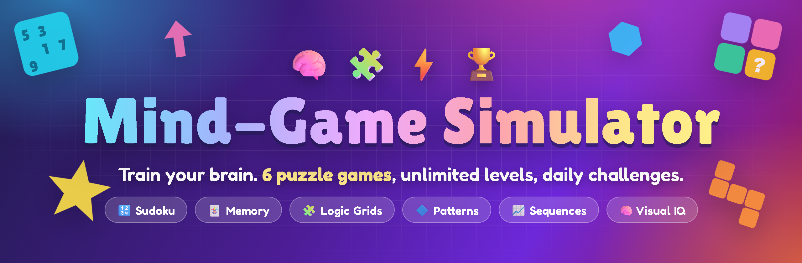
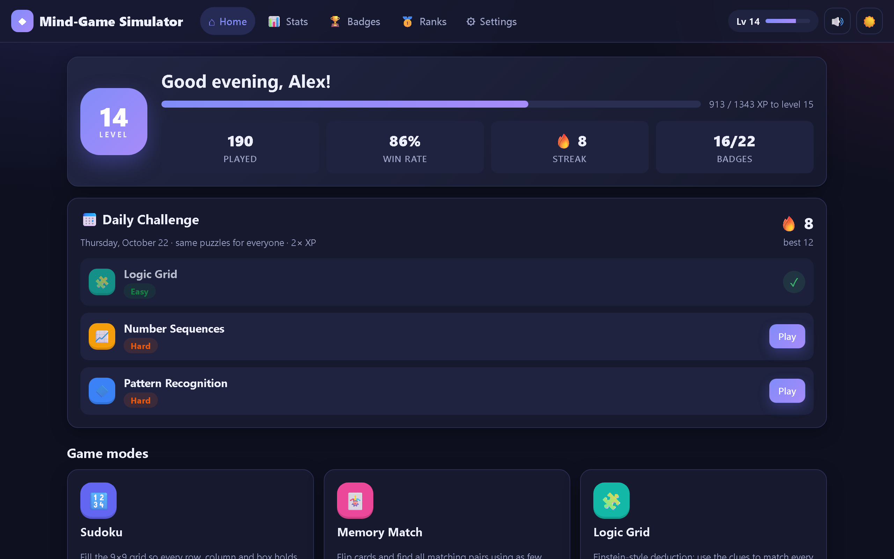
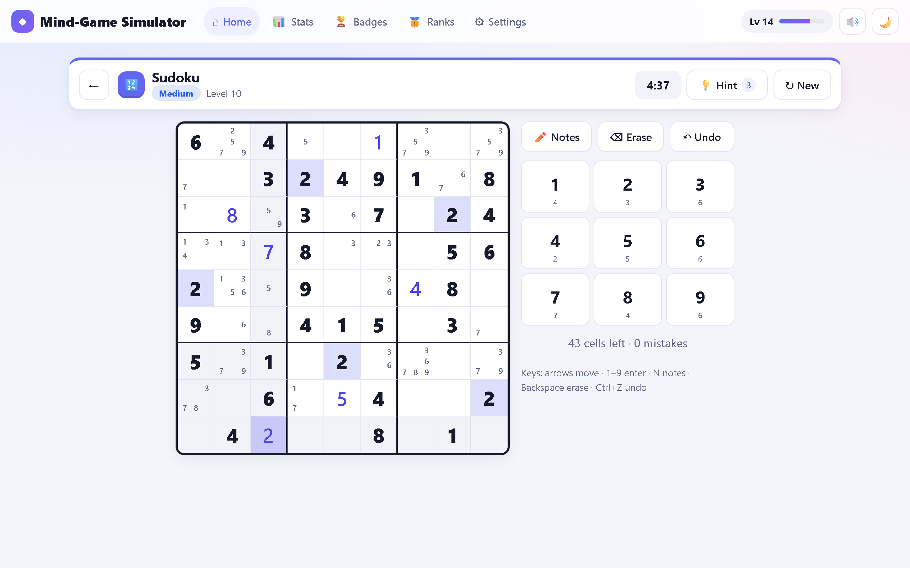
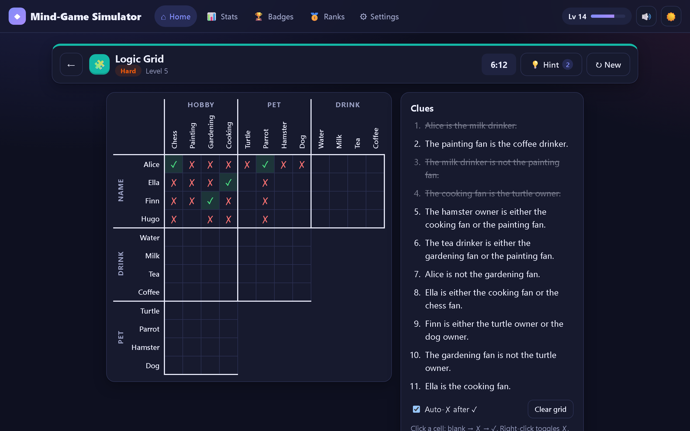
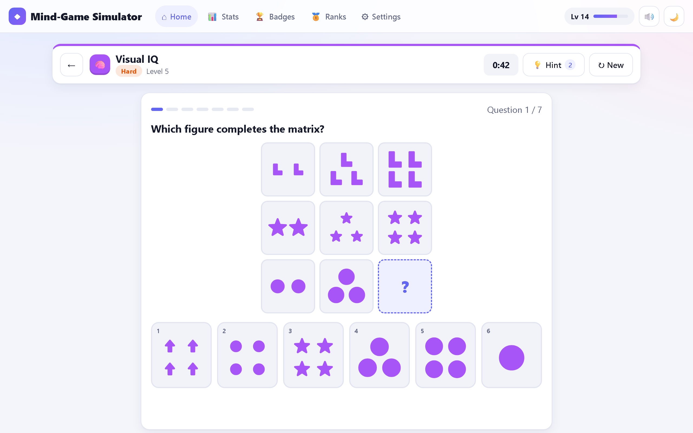
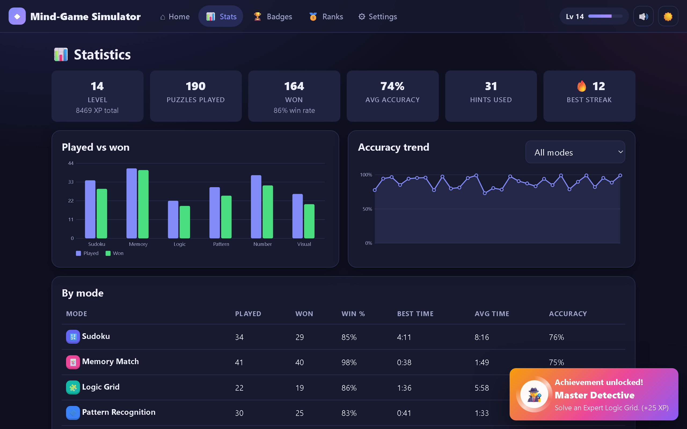
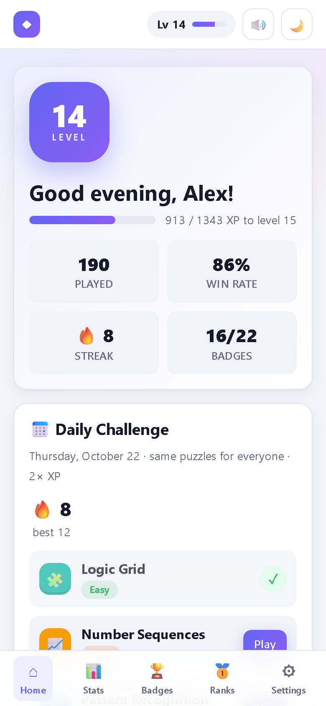
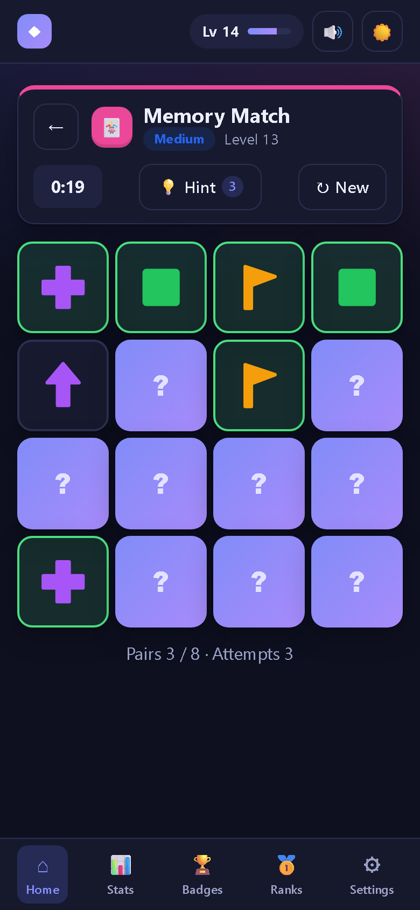

<div align="center">

<a href="https://jaineil32624.github.io/Mind-Game-Simulator/"></a>

<br>

[](https://jaineil32624.github.io/Mind-Game-Simulator/)
[](https://github.com/jaineil32624/Mind-Game-Simulator/releases/latest/download/Mind-Game-Simulator.zip)
[](https://jaineil32624.github.io/Mind-Game-Simulator/)


[](LICENSE)

### 🧠 Six brain games. Infinite puzzles. One daily challenge for the whole world. ⚡

</div>

## 📸 Take a look

<table>
  <tr>
    <td width="50%"><br><sub>🏠 <b>Your dashboard</b> — level, XP, streak and today's challenge</sub></td>
    <td width="50%"><br><sub>🔢 <b>Sudoku</b> — pencil notes, smart highlighting, always one solution</sub></td>
  </tr>
  <tr>
    <td width="50%"><br><sub>🧩 <b>Logic Grid</b> — Einstein-style deduction with ✓ / ✗ marking</sub></td>
    <td width="50%"><br><sub>🧠 <b>Visual IQ</b> — Raven-style matrices, rotations and mirrors</sub></td>
  </tr>
  <tr>
    <td width="50%"><br><sub>🏆 <b>Stats & badges</b> — charts, personal bests and unlock moments</sub></td>
    <td width="50%" align="center">
      &nbsp;
      <br><sub>📱 <b>Plays great on phones</b> — light & dark themes</sub>
    </td>
  </tr>
</table>

## 🎮 6 games, 4 difficulties each

| | Game | What makes it fun |
|---|---|---|
| 🔢 | **Sudoku** | Fresh puzzles every time, each with exactly one solution. Pencil notes and hints that teach real techniques. |
| 🃏 | **Memory Match** | Flip, remember, match. Grids grow up to 6×6 with sneaky look-alike cards. |
| 🧩 | **Logic Grid** | Be the detective: crack Einstein-style clue puzzles, each proven to have one answer. |
| 🔷 | **Pattern Recognition** | Spot the odd one out and predict what comes next. |
| 📈 | **Number Sequences** | Fibonacci, primes, squares and nastier rules. Can you find the next number? |
| 🧠 | **Visual IQ** | Matrix puzzles, mental rotation and mirror-image challenges. |

Every game goes from **Easy** to **Expert**, and the puzzle generator really does get harder: bigger grids, fewer clues, subtler rules. Puzzles are generated on the fly, so you'll never run out.

## 🏆 Level up

- ⭐ **XP & levels.** Earn XP for every solve, with bonuses for accuracy and speed. There's no level cap.
- 🏅 **22 achievement badges.** Each unlock gets its own animated pop-up and jingle.
- 📅 **Daily challenge.** Three fresh puzzles a day, the same for every player in the world, worth **2× XP**.
- 🔥 **Streaks.** Finish the daily challenge every day and watch your streak grow.
- 💡 **Hints that teach.** A limited number per puzzle, paid for with XP, so use them wisely.
- 📊 **Stats.** Personal bests, win rates, accuracy trends and charts for every game.
- 🎵 **Music & sounds.** Calm generated background music and satisfying sound effects. Mute or adjust anytime.
- 🌗 **Light & dark themes**, keyboard shortcuts, and progress that saves itself (export/import included).

## 🚀 Play in 10 seconds

**Option 1 — Play online (fastest)**
👉 Open **[jaineil32624.github.io/Mind-Game-Simulator](https://jaineil32624.github.io/Mind-Game-Simulator/)** and start playing.

**Option 2 — Download & play offline**
1. ⬇ Download **[Mind-Game-Simulator.zip](https://github.com/jaineil32624/Mind-Game-Simulator/releases/latest/download/Mind-Game-Simulator.zip)**
2. 📂 Unzip it
3. 🖱️ Double-click `index.html`. That's it: no install and no internet needed. Works in Chrome, Edge, Firefox and Safari.

**Option 3 — On your phone**
📱 Open the [play link](https://jaineil32624.github.io/Mind-Game-Simulator/) on your phone, then tap **Share → Add to Home Screen** (iPhone) or **⋮ → Add to Home screen** (Android) to get it as an app icon.

<div align="center">

### Like it? ⭐ Star the repo!

[](https://jaineil32624.github.io/Mind-Game-Simulator/)
[](https://github.com/jaineil32624/Mind-Game-Simulator/releases/latest/download/Mind-Game-Simulator.zip)
[](https://github.com/jaineil32624/Mind-Game-Simulator)

</div>

---

<details>
<summary><b>🛠️ For developers: architecture, generators, adding a game mode</b></summary>

<br>

Mind-Game Simulator is plain HTML, CSS and vanilla JavaScript: no libraries, no build step, no CDN and no network calls, so `index.html` runs directly from disk. Internally all code lives on one global namespace, `window.App3`.

## Features

### Game modes
Every mode has four difficulties (**Easy, Medium, Hard, Expert**), and each difficulty changes how puzzles are generated.

| Mode | What it is | How difficulty scales |
|---|---|---|
| 🔢 **Sudoku** | Backtracking generator that produces puzzles with a **unique solution**. Supports notes/pencil marks, conflict highlighting, undo, a number pad and full keyboard control. | 38 / 32 / 27 / ≈23 clues |
| 🃏 **Memory Match** | Flip cards to find matching pairs. Card faces are generated SVG figures. | 3×4 grid with a preview, up to 6×6 with look-alike symbols |
| 🧩 **Logic Grid** | Einstein-style deduction with a random hidden solution. Clues are added until a constraint solver proves the solution is **unique**. Staircase grid with ✗/✓ marking. | 3×3 up to 4×5. Hard and Expert add comparison clues and minimal clue sets |
| 🔷 **Pattern Recognition** | Odd-one-out and "what comes next?" questions using generated shapes, colours, fills, counts, sizes and rotations. | More figures, subtler key traits, more "noise" traits |
| 📈 **Number Sequences** | Arithmetic, geometric, Fibonacci, Tribonacci, interleaved, squares, cubes, triangular, second-order, ×k+c, primes and alternating-operation sequences. | Larger rule pool. Multiple choice on Easy/Medium, typed answers on Hard/Expert, hidden middle terms on Expert |
| 🧠 **Visual IQ** | Raven-style 3×3 matrices with rule-based SVG figures, plus mental-rotation and mirror-image questions on generated chiral polyominoes. | 1 to 4 simultaneous rules, more options, larger shapes, top-bottom flip decoys |

### Meta-game
- **Hints.** Each mode gives its own useful hints. Sudoku explains naked and hidden singles, Logic Grid quotes the clue it applies, quiz modes give a nudge about the rule and then remove wrong options. Hints are limited per puzzle (3/3/2/1) and cost XP (5/10/15/20). A hint never drops you below the start of your current level.
- **Daily challenge.** Three puzzles are generated from a PRNG seeded with the date, so everyone gets the same set on the same day. Completing all three advances your streak. Daily puzzles earn 2× XP.
- **XP and levels.** There is no level cap. Going from level L to L+1 costs `80 + 45·(L−1)^1.3` XP. You earn XP for solving, accuracy, speed relative to par time, and badges.
- **22 achievement badges.** Unlocking one shows an animated toast with a synthesized jingle and gives +25 XP.
- **Statistics per mode.** Played, won, win rate, best time (overall and per difficulty), average time, accuracy and hints. Includes an SVG bar chart (played vs won) and an accuracy trend line.
- **Saving.** Progress goes to `localStorage` using a **versioned schema with migrations** (v1 → v2 → v3). You can export and import the save as JSON or reset it. If storage is blocked, the app falls back to memory.
- **Leaderboard framework.** There is a `LeaderboardProvider` interface, a working `LocalLeaderboardProvider`, and a stub `RemoteLeaderboardProvider` that marks where an HTTP backend plugs in.
- **Interface.** Light and dark themes (following the system by default), responsive layout with a bottom tab bar on phones, smooth transitions, keyboard support, Web Audio sound effects (no audio files) with a mute toggle, and `prefers-reduced-motion` support. Calm procedurally generated background music (toggle + volume in Settings; the header mute button silences everything).

### Puzzle generation guarantees
- All randomness goes through a seeded RNG (`App3.core.RNG`, mulberry32 with string hashing). Puzzles are reproducible from their seed, so daily challenges are identical for everyone.
- There is no level cap. Every new puzzle comes from a fresh seed, and layouts are randomized.
- Every puzzle is checked before it is shown:
  - Sudoku: a solution counter confirms exactly one solution.
  - Logic Grid: the constraint solver counts exactly one solution, and it matches the hidden one.
  - Pattern and Visual IQ: validators check that exactly one option fits the rule and that all options look different.
  - Sequences: the terms are re-checked and the options are unique.
  - Memory: every symbol has exactly one pair.

## How to run
1. Double-click `index.html`, or open it in any modern browser (Chrome, Edge, Firefox, Safari).
2. That's it. Nothing needs installing and no server is required.

If you would rather use a local server: `npx serve .` or `python -m http.server`, then open the printed URL.

### Keyboard shortcuts
- **Global:** `H` asks for a hint. `Esc` closes dialogs.
- **Sudoku:** arrow keys move, `1`–`9` enter a digit, `N` toggles notes, `Backspace` erases, `Ctrl+Z` undoes.
- **Memory:** arrow keys move focus, `Enter`/`Space` flips a card.
- **Quiz modes:** `1`–`9` pick an option, `Enter` goes to the next question.

## Architecture

```
index.html            classic <script> tags in dependency order (works on file://)
css/styles.css        theme tokens, layout, components, animations
js/
  core/
    namespace.js      creates window.App3 { core, systems, games, ui }
    utils.js          DOM builder (el), formatting, dates, deepMerge
    rng.js            seeded PRNG (mulberry32 + string hash)
    eventbus.js       pub/sub that decouples systems from the UI
    storage.js        versioned save, migrations, export/import/reset
    audio.js          Web Audio synthesized sound effects
    music.js          procedural background music (toggle + volume)
  games/
    base-game.js      BaseGame contract (generate/render/getHint/onKey/complete)
    registry.js       game registry; registering a mode is all you need to do
    shared/figures.js procedural SVG figures + polyomino helpers
    shared/quiz-game.js QuizGame base for round-based question modes
    sudoku.js | memory.js | logic-grid.js | pattern.js | sequence.js | visual-iq.js
                      each file holds: engine (generator + validator) + view class
  systems/
    xp.js             level curve, rewards, spending
    stats.js          per-mode statistics
    achievements.js   badge definitions + evaluation
    daily.js          date-seeded challenges + streaks
    leaderboard.js    LeaderboardProvider / Local / Remote stub + scoring
    hints.js          hint limits and XP costs
  ui/
    router.js         hash router (#/home, #/play/<mode>/<difficulty>, #/daily/<i>, …)
    components.js     modal, confirm, progress bar, stat tile, difficulty picker
    toasts.js         notifications + animated achievement toast
    charts.js         SVG bar and line charts
    screens/          home, game, stats, achievements, leaderboard, settings
  main.js             boot: load save, theme, wire events, start router
```

**Design rules**
- Every file is an IIFE that attaches to `window.App3`. There are no ES module imports, so the app runs from `file://`.
- Game engines are **pure**: given an RNG and a difficulty they return plain data, with no DOM access. This keeps them testable in Node.
- Games never touch XP, stats or storage directly. They call `this.complete({ won, accuracy })`, and the game screen handles the bookkeeping: stats, XP, leaderboard, daily progress and achievements.
- Systems talk to the UI through the event bus (`xp:changed`, `level:up`, `achievement:unlocked`, `storage:replaced`, …).

## Adding a new game mode

1. Create `js/games/my-mode.js`:

```js
(function (App3) {
  'use strict';
  var BaseGame = App3.games.BaseGame;
  var el = App3.core.utils.el;

  // Pure engine: draw ALL randomness from rng so daily challenges stay deterministic.
  function generate(rng, difficulty) {
    var size = { easy: 3, medium: 4, hard: 5, expert: 6 }[difficulty];
    return { target: rng.int(1, size * 10) };
  }

  class MyModeGame extends BaseGame {
    generate() { this.puzzle = generate(this.rng, this.difficulty); }
    render() {
      var self = this;
      this.root.appendChild(el('button', { class: 'btn primary',
        onclick: function () { self.complete({ won: true, accuracy: 1 }); } }, 'Win!'));
    }
    getHint() { return { text: 'The answer is ' + this.puzzle.target }; } // optional
    onKey(e) { return false; }                                              // optional
  }

  MyModeGame.meta = {
    id: 'mymode', name: 'My Mode', icon: '✨', color: '#0ea5e9',
    description: 'One-line pitch shown on the home card.',
    parTime: { easy: 60, medium: 90, hard: 120, expert: 180 },          // seconds, for speed XP
    difficultyInfo: { easy: '3×3', medium: '4×4', hard: '5×5', expert: '6×6' }
  };
  MyModeGame.engine = { generate: generate };                           // for tests

  App3.games.registry.register(MyModeGame);
})(window.App3);
```

2. Add `<script src="js/games/my-mode.js"></script>` to `index.html` after the other games and before `js/ui/…`.
3. That's all. The home card, difficulty picker, stats table and charts, leaderboard filter, daily-challenge pool and the *Explorer* badge pick the mode up automatically.

For question-based modes, extend `App3.games.QuizGame` instead. Implement `static buildRound(rng, difficulty)` and `renderStimulus` / `renderOption`, and you get progress dots, answer feedback, option elimination hints and keyboard control for free.

## Plugging in an online leaderboard
`js/systems/leaderboard.js` contains `RemoteLeaderboardProvider`, which expects:

- `POST {endpoint}/scores` → `{ rank }`
- `GET {endpoint}/scores?mode=&difficulty=&limit=` → `[entries]`

Once you have a backend:

```js
App3.systems.leaderboard.setProvider(
  new App3.systems.leaderboard.RemoteLeaderboardProvider({ endpoint: 'https://api.example.com', apiKey: '…' })
);
```

A real backend should validate submissions on the server, for example by regenerating the puzzle from its seed and checking the solve time.

## Save format and migrations
The save lives under the `localStorage` key `app3.save` and always carries a `version`. To change the schema, bump `VERSION` in `js/core/storage.js` and add `MIGRATIONS[oldVersion]`. Older saves and exported files are upgraded step by step, then deep-merged onto fresh defaults.

## Known limitations
- Progress is stored per browser and per origin. Browsers may keep `file://` storage separate from `http://localhost` storage, and some browsers isolate storage for each local file. Use Export/Import to move a save.
- The online leaderboard is a stub. Only the local (this device) board stores scores.
- Number sequences and pattern questions are checked against the rule that generated them. A creative player might find a different rule that also fits the shown terms; the explanation shown after each answer says which rule was intended.
- Sudoku difficulty is set by clue count, not by which solving techniques are required. Expert puzzles stop at ≈23–26 clues, wherever no further clue can be removed without losing uniqueness.
- Sound needs one user interaction before it can play, because of browser autoplay rules.

</details>

## 📜 License
MIT — see [LICENSE](LICENSE). © 2026 Jaineil Rana.
